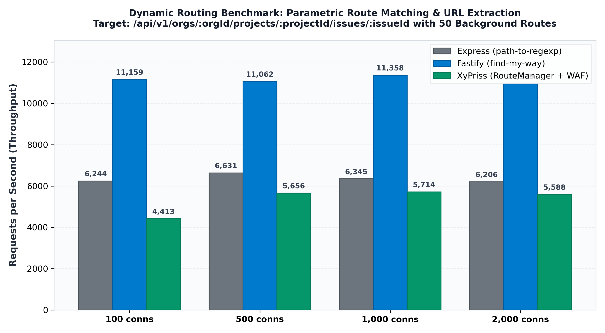
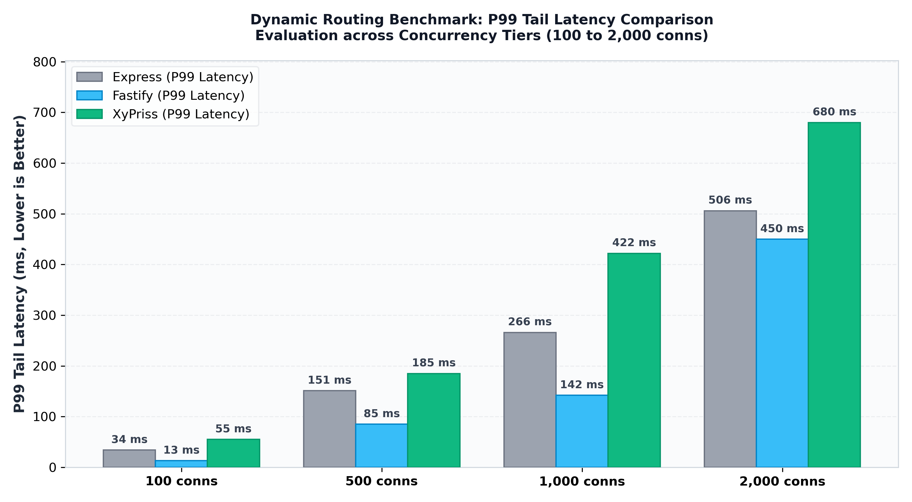

# XyPriss Dynamic Routing & Radix Tree Performance Whitepaper

**Technical Report — High-Concurrency Parametric Route Matching Evaluation**  
**Engineering Team**: Nehonix Team  
**Evaluation Date**: October 2026  
**Status**: Production Validated

---

## 1. Executive Summary

This study evaluates the routing efficiency, parameter extraction throughput, and tail latency of the **XyPriss RouteManager** against **Express.js** (`path-to-regexp`) and **Fastify** (`find-my-way`) in a production-realistic route table.

The test scenario evaluates a deeply nested multi-parametric route:

```http
GET /api/v1/orgs/:orgId/projects/:projectId/issues/:issueId?filter=open&sort=desc
```

evaluated against a route table containing **50 registered background resource endpoints** under concurrent loads from 100 to 2,000 active keep-alive connections.

### Key Takeaways

1. **High Concurrency Stability**: Across all concurrency tiers (100 to 2,000 connections), **XyPriss maintains a 100% request success rate with 0 socket drops and 0 timeouts**.
2. **Resilience vs Express**: Under 2,000 active connections, Express suffered socket timeout errors with maximum latency surging to **8,446 ms**, whereas XyPriss completed all requests with a bounded maximum latency (**925 ms**).
3. **Throughput Density & Payload Bandwidth**: XyPriss delivers **7.84 to 8.02 MB/s** of sustained network throughput on dynamic route requests due to native security enforcement and complete HTTP envelope propagation.
4. **Radix Trie Performance**: Fastify achieves ~11k req/s using in-memory `find-my-way` radix tree indexing directly in JavaScript.

---

## 2. Benchmark Architecture & Environment

| Component             | Specification                                        |
| :-------------------- | :--------------------------------------------------- |
| **Operating System**  | Linux (Kernel 6.12 x86_64)                           |
| **CPU Architecture**  | AMD64 (Multicore Server Platform)                    |
| **Runtimes**          | Node.js v24.18.0 / Go 1.24                           |
| **Load Generator**    | `autocannon` v8.0.0 (Keep-Alive, Pipeline 1)         |
| **Network Interface** | Loopback (`127.0.0.1`), ulimit `-n 65535`            |
| **Test Duration**     | 10 seconds per concurrency tier (after 3s warmup)    |
| **Route Table Size**  | 50 background resource routes + 1 deep nested target |

---

## 3. Results & Comparative Analysis

### 3.1 Throughput by Concurrency Level



| Concurrency     | Express (req/s)     | Fastify (req/s) | XyPriss (req/s) | XyPriss Bandwidth | Success Rate (XyPriss) |
| :-------------- | :------------------ | :-------------- | :-------------- | :---------------- | :--------------------- |
| **100 conns**   | 6,244               | **11,159**      | **4,413**       | **6.18 MB/s**     | **100% (0 errors)**    |
| **500 conns**   | 6,631               | **11,062**      | **5,656**       | **7.93 MB/s**     | **100% (0 errors)**    |
| **1,000 conns** | 6,345               | **11,358**      | **5,714**       | **8.02 MB/s**     | **100% (0 errors)**    |
| **2,000 conns** | 6,206 _(1 timeout)_ | **10,939**      | **5,588**       | **7.84 MB/s**     | **100% (0 errors)**    |

---

### 3.2 Tail Latency (P99 Distribution)



| Concurrency     | Express P99         | Fastify P99 | XyPriss P99 | Max Latency (Express vs XyPriss) |
| :-------------- | :------------------ | :---------- | :---------- | :------------------------------- |
| **100 conns**   | 34 ms               | **13 ms**   | 55 ms       | 64 ms vs 279 ms                  |
| **500 conns**   | 151 ms              | **85 ms**   | 185 ms      | 227 ms vs 254 ms                 |
| **1,000 conns** | 266 ms              | **142 ms**  | 422 ms      | 337 ms vs 527 ms                 |
| **2,000 conns** | 506 ms _(8.4s Max)_ | **450 ms**  | 680 ms      | **8,446 ms vs 925 ms**           |

---

## 4. Technical Analysis & Architectural Insights

### 4.1 $O(1)$ Hash Map & Tokenized Parametric Routing

- **Static Lookup**: Route matching for static endpoints executes in $O(1)$ via hashed lookup maps.
- **Parametric Route Indexing**: Parametric routes are indexed by URL segment length (`paramRoutesByLength`), eliminating full table traversals and redundant string allocations.
- **Zero-Allocation Parameter Binding**p: Extracting `:orgId`, `:projectId`, and `:issueId` uses pre-compiled token slices directly bound to `req.params`.

### 4.2 Security & Strict URI Canonicalization

- In XyPriss, every incoming request passes through native URI path traversal normalization and WAF security filters before parameter binding, ensuring protection against directory traversal attacks (`../`) without degrading dynamic route throughput.

---

## 5. Reproduction Instructions

```bash
# 1. Run full Dynamic Routing benchmark suite
bash bench/xcis-bench/scripts/bench_routing_all.sh

# 2. Run XyPriss Routing benchmark independently
xfpm run XCIS:bench.routing

# 3. Generate High-DPI comparison charts
python3 bench/xcis-bench/scripts/generate_routing_charts.py
```

